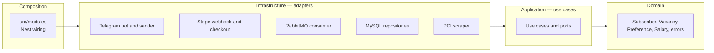
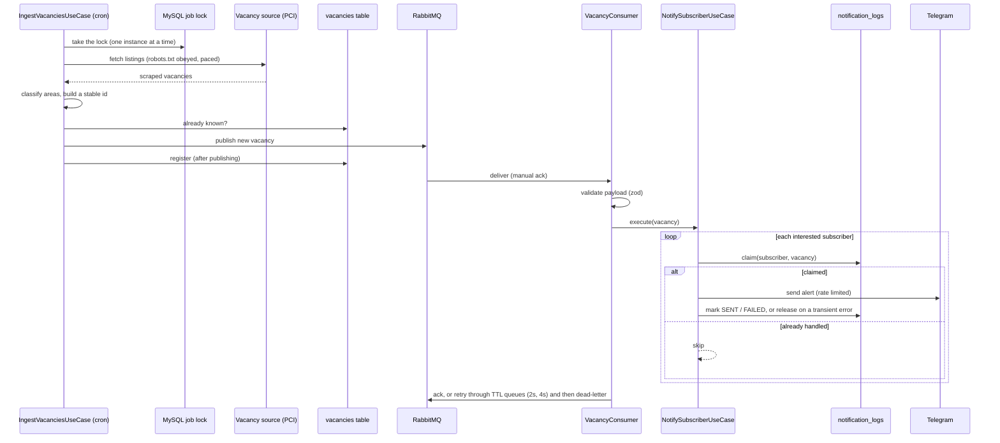
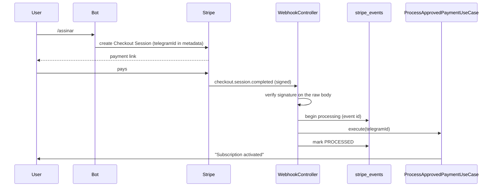

# Architecture

Radar de Concursos is a NestJS application organised as a **hexagonal architecture** (ports and
adapters). This document explains the structure, the main flows and how the rules are enforced.
Individual decisions and their trade-offs live in [`docs/adr`](adr/README.md).

## Layers

Dependencies point inwards. The domain knows nothing about the outside world.

| Layer          | Path                                              | Responsibility                                                                    | May depend on       |
| -------------- | ------------------------------------------------- | --------------------------------------------------------------------------------- | ------------------- |
| Domain         | `src/domain`                                      | Business rules and value objects, domain errors, repository and service **ports** | nothing             |
| Application    | `src/application`                                 | Use cases that orchestrate the domain through ports; `ILogger` port               | domain              |
| Infrastructure | `src/infrastructure`                              | Adapters: Telegram, Stripe, RabbitMQ, MySQL, scraper                              | application, domain |
| Composition    | `src/modules`, `src/app.module.ts`, `src/main.ts` | Wiring only: Nest modules, providers, bootstrap                                   | everything          |
| Shared         | `src/shared`                                      | Typed config, injection tokens, `provideUseCase`                                  | —                   |

Domain and application code contain **no framework imports** (no NestJS, TypeORM, Telegraf, Stripe,
Axios or amqplib). Use cases are plain classes registered with Nest through `provideUseCase`.

## Feature modules

`AppModule` only composes these modules:

| Module                | Provides                                                                   |
| --------------------- | -------------------------------------------------------------------------- |
| `AppConfigModule`     | Validated, typed `AppConfig` (the only reader of `process.env`)            |
| `LoggingModule`       | Binds the `ILogger` port to the NestJS logger                              |
| `PersistenceModule`   | MySQL connection and repository adapters bound to their ports              |
| `TelegramModule`      | The Telegraf client and the notification adapter                           |
| `SubscribersModule`   | Sign-up, preferences, salary filter, activation and cancellation use cases |
| `BillingModule`       | Stripe client and the webhook controller                                   |
| `TelegramBotModule`   | Commands and button callbacks                                              |
| `NotificationsModule` | Vacancy consumer and the notify use case                                   |
| `ScrapingModule`      | Scheduled scraper that publishes vacancies                                 |
| `MonitoringModule`    | Dead-letter queue alerts                                                   |

## Flow: a vacancy becomes an alert

- **Idempotency** is claim-first: the `(telegramId, vacancyId)` pair is reserved with an atomic
  insert before sending, so concurrent consumers and redelivered messages never duplicate an
  alert ([ADR 0006](adr/0006-claim-first-idempotency.md)).
- **Failures propagate**: the Telegram adapter returns a `DeliveryResult`; transient failures make
  the use case throw so the message is retried and finally dead-lettered
  ([ADR 0005](adr/0005-rabbitmq-retry-and-dlq.md)).

## Flow: a payment activates a subscription

Stripe delivers events at least once, so the webhook records each event id and the use cases
are idempotent. The Telegram id is copied onto the subscription (`subscription_data.metadata`),
otherwise cancellation events could not be matched to a user.

## Enforced rules

`npm run arch:check` (dependency-cruiser, run in CI) fails the build when:

- the domain imports anything outside the domain, or any framework;
- the application imports infrastructure, wiring or any framework;
- infrastructure imports the Nest modules that compose it;
- test helpers are used outside specs;
- a circular dependency appears (ORM entities are exempt: bidirectional relations are circular).

See [ADR 0009](adr/0009-architecture-rules-in-ci.md). The rules live in
[`.dependency-cruiser.cjs`](../.dependency-cruiser.cjs).

## Testing strategy

| Level               | What                                                                                                                                                   | Where                                               |
| ------------------- | ------------------------------------------------------------------------------------------------------------------------------------------------------ | --------------------------------------------------- |
| Unit                | Domain rules, use cases with in-memory ports, mappers, formatters, config validation                                                                   | `*.spec.ts`                                         |
| Integration-style   | Webhook with signed payloads, Nest dependency injection of controllers                                                                                 | `*.spec.ts`                                         |
| Integration (MySQL) | Repositories against a real database built by the migrations: SQL matching versus the domain rule, concurrent idempotency claims, the Stripe event log | `*.integration.spec.ts`, `npm run test:integration` |
| End to end          | The real app against real MySQL and RabbitMQ with a fake Telegram Bot API, including retries through the TTL queues                                    | `npm run smoke`                                     |

## Known limitations

See the README. In short: listings titled "Vários Cargos" carry no role information, and the only source
today is a commercial site whose data should not be reused in a paid product without permission
([ADR 0013](adr/0013-vacancy-source-policy.md)).
